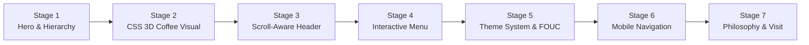

# Manager Demonstration Guide — Aurel & Bean Premium Café Website

**Document Version:** 1.0  
**Project:** Aurel & Bean — Premium Café Website  
**Assignment:** Aravex Tech Studio — Frontend Learning & R&D  
**Target Audience:** Developer (Presenter) & Evaluating Technical Manager  
**Scope:** Standalone Frontend-Only Web Application  

---

## 1. Demonstration Purpose & Scope

This guide provides a structured, professional script for demonstrating the *Aurel & Bean* premium café website to the technical manager. It aligns the live user experience with the manager's product requirements (**FR-01 through FR-09**) while preserving strict technical and factual honesty.

### Demonstration Grounding & Ethical Disclosures:
- **Illustrative Portfolio Concept:** The café brand, offerings, prices, schedule, and location represent a curated demonstration concept.
- **Local Typed Dataset:** All 12 menu items are statically authored in TypeScript (`src/data/menu.ts`). Zero external coffee APIs or live inventory databases are utilized.
- **Pure Frontend Architecture:** No custom backend, Express server, database, customer accounts, or payment processing are implemented or implied.
- **CSS 3D-Style Presentation:** Depth effects are powered by native hardware-accelerated CSS 3D transforms (`perspective`, `rotateX`, `rotateY`, `translateZ`), not heavyweight WebGL or Three.js polygon meshes.
- **Informational Cards & Interactive Controls:** `ProductCard.tsx` renders as an informational `<article>`, presenting sensory notes, origins, and tags. Menu interactivity is delivered by `CategoryFilter.tsx` toggle pills and the `EmptyState.tsx` reset action.

---

## 2. Manager Requirements Traceability

| Requirement ID | Requirement Name | Demonstration Focus | Implementation Location |
|---|---|---|---|
| **FR-01** | Modern, Premium Hero | Typography hierarchy, sole `<h1>`, dual CTAs (`#menu`, `#about`), responsive framing. | `src/components/sections/Hero.tsx` |
| **FR-02** | 3D Coffee Visual | CSS 3D perspective (`1000px`), stage tilt ($6^\circ / -8^\circ$), $+16\text{px} Z$-depth parallax, roasted contact shadow. | `src/components/ui/HeroVisual.tsx` |
| **FR-03** | Interactive Menu Cards | Category filter toggles, live count updates, informational product cards, sensory notes, terroir metadata. | `src/components/sections/MenuSection.tsx` `src/components/ui/CategoryFilter.tsx` |
| **FR-04** | Smooth Transitions | Measured 200ms–700ms ease-out transitions on hover, modal drawer, theme menu, and scroll elevation. | `src/app/globals.css` Component Tailwind classes |
| **FR-05** | Scroll-Based Effects | Passive scroll listener at 40px threshold toggling Navbar elevation, border definition, and backdrop density without layout shift. | `src/components/layout/NavbarShell.tsx` |
| **FR-06** | Elegant Typography | Editorial pairings: Fraunces (display serif) + Manrope (body sans) via self-hosted `next/font/google`. | `src/app/layout.tsx` `src/app/globals.css` |
| **FR-07** | Responsive Layout | Seamless adaptation from 320px narrow mobile to 1920px widescreen, including mobile landscape and zoom reflow. | Full component suite |
| **FR-08** | Working Source Code | Next.js 16.4.6 App Router, TypeScript 5, Turbopack static compilation, 33 passing automated tests. | Project repository |
| **FR-09** | HLD and LLD Diagrams | Accurate architecture diagrams matching implemented Server Components, client islands, and data flows. | `docs/HLD.md` `docs/LLD.md` |
| **FR-10** | LinkedIn Demonstration | Recorded video/screenshots and company mention following publication guidelines. | *Pending Developer Action* |

---

## 3. Seven-Stage Demonstration Walkthrough Script

Follow this sequential walkthrough during the presentation:

### Stage 1: Premium Hero Presentation
- **Action:** Open the homepage at `http://localhost:3000` on a desktop viewport ($1280\text{px}$–$1440\text{px}$).
- **Observation:**
  - Notice the clear visual hierarchy: single page `<h1>` (*"Crafted with care. Savored slowly."*), subtle eyebrow tag, and brief brand description.
  - Observe the dual call-to-action buttons: primary filled pill (`"Explore Menu"`) jumping to `#menu` and secondary outlined pill (`"Our Story"`) jumping to `#about`.
  - Notice the harmonious pairing of Fraunces (editorial display serif) and Manrope (clean sans-serif body).
- **Requirement Satisfied:** **FR-01** (Modern Hero), **FR-06** (Typography).
- **Technical Explanation:** Rendered as a pure React Server Component with zero client JavaScript overhead, optimizing initial paint and First Contentful Paint (FCP).

### Stage 2: CSS 3D-Style Coffee Visual
- **Action:** Hover the pointer over the ceramic coffee cup composition on the right side of the Hero.
- **Observation:**
  - The frosted stage card tilts dynamically in 3D space ($+6^\circ$ on X-axis, $-8^\circ$ on Y-axis).
  - The ceramic saucer, cup, crema, and latte art rosette translate forward along the Z-axis by $+16\text{px}$, producing an unmistakable optical parallax gap between the cup and the stage.
  - The 3-tier roasted shadow system (`#2B201B`, `#3E2718`, `#5C381E`) moves cohesively with the saucer, grounding the cup on the plane.
  - Ambient radial warmth glow softens and brightens on hover.
  - Move pointer away: the stage card smoothly returns to its resting planar state over a 700ms ease-out curve.
- **Requirement Satisfied:** **FR-02** (3D Coffee Visual), **FR-04** (Smooth Transitions).
- **Technical Explanation:** Employs hardware-accelerated CSS 3D transforms (`[perspective:1000px]`, `[transform-style:preserve-3d]`, `rotateX`, `rotateY`, `translateZ`) executed entirely by the GPU compositor thread without shipping heavyweight WebGL or Three.js dependencies. Neutralized cleanly when `prefers-reduced-motion: reduce` is enabled.

### Stage 3: Minimal Scroll-Aware Navbar
- **Action:** Scroll down slowly from the top of the page toward the menu section.
- **Observation:**
  - At the page summit ($y \le 40\text{px}$), the header rests in a subtle semi-translucent state (`bg-background/60`, `backdrop-blur-xs`, `shadow-none`).
  - Immediately upon crossing the $40\text{px}$ threshold, the header smoothly elevates into a denser frosted glass bar (`bg-background/90`, `backdrop-blur-md`, `border-border/80`, `shadow-xs`).
  - Text behind the header blurs smoothly without obscuring navigation labels.
  - Scroll back to the top: the header seamlessly reverts to its resting state.
- **Requirement Satisfied:** **FR-05** (Scroll-Based Effects), **FR-04** (Smooth Transitions).
- **Technical Explanation:** Managed by an isolated Client Component island (`NavbarShell.tsx`) wrapping a pure Server Component (`Navbar.tsx`). A passive scroll listener (`{ passive: true }`) ensures scrolling is never blocked, while a boolean state gate prevents unnecessary React re-renders during active scrolling. Container height is locked (`h-16 sm:h-20`), ensuring zero Cumulative Layout Shift (CLS).

### Stage 4: Interactive Menu Filtering
- **Action:** Scroll to the `#menu` section. Click through the category filter pills: `All`, `Espresso`, `Brewed`, `Cold Craft`, and `Pastries`.
- **Observation:**
  - Active pill highlights with solid accent styling; inactive pills display item count badges derived from the dataset (`12` total, `3` per category).
  - Product grid filters instantaneously without page reloads or layout shift.
  - Accessible counter below pills announces the update: *"Showing 3 offerings in Espresso"*.
  - Product cards present unclipped descriptions, formatted USD prices (e.g. `$4.85`), signature badges, origin metadata (`Huila, Colombia`), and specialty tags.
- **Requirement Satisfied:** **FR-03** (Interactive Menu Cards).
- **Technical Explanation:** Production filtering logic is encapsulated in pure, typed utilities (`filterMenuItems` and `deriveCategoryCounts` in `src/lib/utils.ts`) reused directly by `MenuSection.tsx` and covered by 9 automated contract tests. `ProductCard.tsx` acts as an informational `<article>`, ensuring accessible semantic markup.

### Stage 5: Light, Dark, and System Theme Switching
- **Action:** Click the theme toggle icon in the header (or focus via keyboard). Select `Dark`, then `Light`, then `System`.
- **Observation:**
  - Semantic design tokens adapt instantaneously across all elements: backgrounds, surfaces, borders, typography, and SVG ceramic glazes.
  - In dark mode, ambient glow opacity is dialed back and tabletop shadows shift to rich black tints (`fill-black/70`) to preserve contrast.
  - Refresh the page while in dark mode: observe **zero flash of unstyled content (FOUC)**.
- **Requirement Satisfied:** **FR-06** (Elegant Typography & Contrast), **NFR-05** (WCAG AA/AAA Contrast).
- **Technical Explanation:** Managed via a synchronous, zero-flash `<head>` script in `src/app/layout.tsx` that reads `localStorage` before `<body>` render, paired with React 19's `useSyncExternalStore` in `ThemeToggle.tsx` for multi-tab and OS preference synchronization.

### Stage 6: Responsive Mobile Navigation
- **Action:** Open browser DevTools and switch to mobile emulation (e.g. iPhone SE, $375\text{px}$ width). Tap the hamburger menu trigger.
- **Observation:**
  - A mobile drawer slides smoothly from the right, covered by a full-screen backdrop overlay.
  - Focus is automatically transferred to the drawer close button.
  - Press the `Tab` key: focus is trapped strictly inside the drawer.
  - Press the `Escape` key: the drawer dismisses immediately, returning focus to the hamburger button.
  - Tap the `"Visit"` link: the drawer closes, body scroll unlocks, and the page scrolls smoothly to the `#contact` section.
- **Requirement Satisfied:** **FR-07** (Responsive Layout), **NFR-03** (Keyboard Accessibility).
- **Technical Explanation:** `MobileNav.tsx` mounts its drawer directly to `document.body` via `createPortal`, completely escaping the `<header>` element's `backdrop-filter` containing block and stacking context. Body scroll is locked via `document.body.style.overflow = "hidden"`.

### Stage 7: Brand Story & Sanctuary Information
- **Action:** Scroll through the `#about` and `#contact` sections down to the `<footer>`.
- **Observation:**
  - About section: Asymmetrical editorial layout with a manifesto quote panel (*"True luxury is not defined by excess, but by the presence of time..."*) and three structured craft pillars (*01 / Terroir*, *02 / Extraction*, *03 / Hospitality*).
  - Contact section: Balanced dual-column layout featuring ritual visiting hours, a semantic `<address>` block, and explicit portfolio demonstration disclosures (*"An illustrative destination conceived for artisanal coffee..."*).
  - Footer: Clean 4-column layout synchronizing brand summary, quick anchor navigation, opening hours, and copyright notice.
- **Requirement Satisfied:** **FR-07** (Responsive Composition), **FR-08** (Complete Frontend Experience).
- **Technical Explanation:** Both sections are static React Server Components shipping zero client JavaScript, perfectly balancing brand atmosphere with honest portfolio disclosures.

---

## 4. Evaluator Q&A and Technical Rationale

Be prepared to answer these common technical architecture questions:

1. **Why use CSS 3D transforms instead of Three.js or WebGL?**  
   *Answer:* Three.js adds $500\text{ KB}+$ of client JavaScript and requires WebGL canvas contexts that introduce significant mobile battery and performance overhead. CSS 3D transforms (`perspective`, `rotateX`, `rotateY`, `translateZ`) achieve authentic depth parallax while running natively on the GPU compositor thread with 0 KB of additional runtime libraries.

2. **Why are ProductCards informational articles rather than interactive buttons?**  
   *Answer:* In accordance with frontend accessibility standards, `<button>` and `<a>` elements should only be used when an action or navigation occurs. The café website uses `ProductCard.tsx` as an informational `<article>` to display coffee origins and tasting notes, while reserving interactive controls strictly for category filtering (`CategoryFilter.tsx`) and menu reset (`EmptyState.tsx`).

3. **How does the theme switcher prevent Flash of Unstyled Content (FOUC)?**  
   *Answer:* Next.js Server Components cannot access browser `localStorage` during build or server rendering. To prevent a flash of white when a dark-mode visitor opens the page, an inline blocking script in `<head>` reads `localStorage` and toggles `.dark` on `document.documentElement` before the browser paints the body.

4. **Why are HTTP security headers configured in `next.config.ts`?**  
   *Answer:* Defining `X-Content-Type-Options: nosniff`, `Referrer-Policy: strict-origin-when-cross-origin`, `X-Frame-Options: SAMEORIGIN`, and `Permissions-Policy` in `next.config.ts` provides a framework-native defense-in-depth baseline that is served automatically by Next.js production servers and edge platforms.

---

## 5. LinkedIn Demonstration Video Guidelines (FR-10)

When recording the required demonstration video or capturing screenshots:
- **Duration:** Aim for 60 to 90 seconds.
- **Resolution:** 1080p ($1920 \times 1080$) desktop capture, followed by a brief 375px mobile emulator segment.
- **Flow:** Follow the 7-stage walkthrough script in Section 3.
- **Company Mention:** Tag **Aravex Tech Studio** in the post copy as specified in the assignment guidelines.
- **Confidentiality:** Ensure zero references to proprietary attendance or internal studio projects appear on screen or in repository links.
