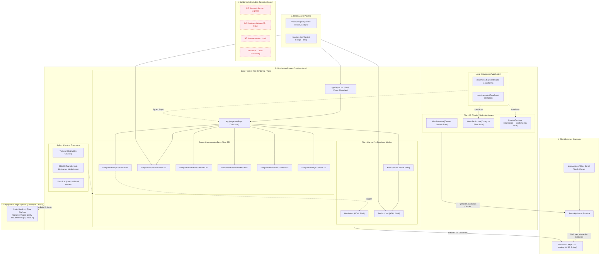

# High-Level Design (HLD) — Premium Café Website

**Document Version:** 1.1 (Final Planning Baseline)  
**Project:** Premium Café Website  
**Scope:** Frontend-only internship learning assignment  
**Status:** Complete — awaiting developer approval  

---

## 1. System Overview and Goals

The Premium Café Website is an accessible, standalone frontend application designed to showcase artisan coffee selections, café atmosphere, and interactive menu offerings.

### Key Objectives
1. **Frontend-Only Architecture:** Standalone delivery with zero dependency on databases, user authentication, custom backend APIs, or payment gateways.
2. **Next.js App Router Foundation:** Intentional distribution of Server Components (for static content, layouts, and initial markup) and Client Components (strictly where browser state, event handlers, or browser APIs are required).
3. **CSS 3D-Style Presentation:** Authentic visual depth using hardware-accelerated CSS 3D perspective and transforms rather than heavyweight 3D mesh engines.
4. **Context-Aware Responsiveness:** Purpose-driven responsive engineering tailored to component roles across all viewports (320px mobile to 1920px widescreen), avoiding rigid universal sizing formulas.
5. **Craftsmanship and Accessibility:** Semantic HTML5 landmarks, keyboard navigability, visible focus indicators, and reduced-motion support.

---

## 2. Next.js App Router & Rendering Architecture

### 2.1 Rendering Lifecycle and Mechanics

Understanding how Next.js App Router renders components avoids common misconceptions about Server versus Client Components:

```
[ Build / Request Phase ]
       │
       ├─► Server Components:
       │     Rendered to static HTML markup + React Server Component (RSC) Payload.
       │     Zero component JavaScript is sent to the client.
       │
       └─► Client Components ('use client'):
             Pre-rendered into static HTML markup on the server for initial delivery.
             JavaScript bundle is prepared for client-side hydration.
       │
       ▼
[ Client Browser Runtime ]
       │
       ├─► 1. Initial Paint:
       │     Browser displays pre-rendered HTML immediately (fast First Contentful Paint).
       │
       └─► 2. Hydration:
             React loads Client Component JavaScript chunks and hydrates only the
             interactive islands, attaching event listeners (onClick, useState).
```

### 2.2 Server Components vs. Client Components

1. **Server Components (RSC):**
   - Render during build time (Static Site Generation / SSG) or on the server.
   - Shipped as lightweight HTML and RSC data; no component source JS is downloaded by the client browser.
   - **CSS-Only Animations in Server Components:** Pure CSS transitions, `@keyframes`, hover states, and CSS 3D perspective transforms can execute entirely within Server Components because they rely on native browser CSS rendering, not React runtime JavaScript.

2. **Client Components (`'use client'`):**
   - Pre-rendered to static HTML on the server, then hydrated in the browser.
   - Reserved strictly for components requiring React state (`useState`), effects (`useEffect`), or browser-side event listeners (`onClick`, `onKeyDown`, pointer events).

---

## 3. Component Boundary and Module Architecture

### 3.1 Server vs. Client Component Assignment

To maintain optimal load times and architectural cleanliness, Client Components are restricted to interactive leaves. Boundaries for components with flexible interaction requirements are finalized during Low-Level Design (LLD):

| Component | Architecture Role | State / Interaction Responsibility | Rationale |
|---|---|---|---|
| `layout.tsx` | **Server Component** | Root HTML structure, `next/font` configuration, global metadata | Static outer framing; no interactive state. |
| `page.tsx` | **Server Component** | Page orchestrator, distributes local menu data | Composition only; no browser hooks. |
| `Navbar` | **Server Component** | Header container, brand logo, desktop navigation anchors | Static navigation links. |
| `MobileNavDrawer` | **Client Component** | Hamburger button, slide-out drawer, focus management | Requires `useState` for drawer open/close and keyboard focus trap. |
| `HeroSection` | **Server Component** | Headline, brand messaging, primary anchor CTA, background | Static presentation. CSS animations run natively. |
| `HeroVisual` (3D Element) | **Deferred to LLD** *(Server or Client)* | Layered coffee visual with CSS 3D perspective | **Server Component** if using pure CSS hover/perspective; **Client Component** only if tracking pointer coordinates via JS. |
| `FeaturedSection` | **Server Component** | Highlighted chef specials presentation | Pure presentation of static data. |
| `MenuSection` | **Client Component** | Category filter tabs and dynamic product list | Requires `useState` to track active category and compute filtered items. |
| `ProductCard` | **Deferred to LLD** *(Server or Client)* | Card presentation and interaction | **Server Component** if interactions are CSS hover/link-based; **Client Component** if requiring modal/drawer expansion or stateful toggles. |
| `AboutSection` | **Server Component** | Café heritage, roasting philosophy, static gallery | Pure presentation. |
| `ContactSection` | **Server Component** | Location details, operating hours, directions link | Pure presentation. |
| `Footer` | **Server Component** | Copyright, footer navigation, social links | Pure presentation. |

### 3.2 Directory Structure

```
src/
├── app/
│   ├── layout.tsx         # Root layout (fonts, metadata, navbar/footer placement)
│   ├── page.tsx           # Single-page orchestrator
│   └── globals.css        # Tailwind directives, CSS custom properties, keyframes
├── components/
│   ├── layout/
│   │   ├── Navbar.tsx     # Server Component navigation bar
│   │   ├── MobileNav.tsx  # Client Component mobile drawer
│   │   └── Footer.tsx     # Server Component footer
│   ├── sections/
│   │   ├── Hero.tsx       # Server Component hero section
│   │   ├── Featured.tsx   # Server Component featured highlights
│   │   ├── MenuSection.tsx# Client Component menu container with filtering
│   │   ├── About.tsx      # Server Component brand story
│   │   └── Contact.tsx    # Server Component hours and location
│   └── ui/
│       ├── Button.tsx     # Reusable contextual button (variants via cva/cn)
│       ├── ProductCard.tsx# Menu card (boundary finalized in LLD)
│       ├── Badge.tsx      # Specialty tags (e.g., "Organic", "Signature")
│       └── ThreeDCard.tsx # CSS 3D perspective wrapper
├── data/
│   └── menu.ts            # Immutable typed café dataset
├── types/
│   └── menu.ts            # TypeScript interfaces (MenuItem, Category, etc.)
└── lib/
    └── utils.ts           # Shared cn() utility (clsx + tailwind-merge)
```

---

## 4. Local TypeScript Data Architecture

The application operates entirely on local, typed data to ensure 100% offline reliability.

### 4.1 Data Model (`src/types/menu.ts`)
```typescript
export type MenuCategory = 'all' | 'espresso' | 'brewed' | 'cold-craft' | 'pastries';

export interface MenuItem {
  readonly id: string;
  readonly name: string;
  readonly category: MenuCategory;
  readonly description: string;
  readonly price: number;
  readonly currency: string;
  readonly image: string;
  readonly featured: boolean;
  readonly tags?: readonly string[];
}
```

### 4.2 Data Flow Mechanics
1. **Source of Truth:** `src/data/menu.ts` defines `MENU_ITEMS: readonly MenuItem[]`.
2. **Top-Down Distribution:** `src/app/page.tsx` imports `MENU_ITEMS` and passes them directly to `<MenuSection items={MENU_ITEMS} />` and `<Featured items={featuredItems} />` as immutable props.
3. **In-Memory Filtering:** `<MenuSection>` initializes `activeCategory` state (`useState<MenuCategory>('all')`). Filtering is performed via simple array operations (`items.filter(...)`).
4. **Resilience:** Because data is embedded at build time, there are zero network request failures, zero loading spinners, and zero runtime API rate limits.

---

## 5. Visual Styling and CSS 3D-Style Architecture

### 5.1 CSS 3D-Style Effects vs. Actual 3D Models

To prevent unrealistic technical overhead while meeting manager requirements:
- **What this project uses:** **CSS 3D-style visual effects**. This technique combines high-resolution transparent visual assets (e.g. coffee cup, floating coffee beans) with CSS 3D perspective:
  ```css
  .perspective-container {
    perspective: 1000px;
  }
  .preserve-3d-card {
    transform-style: preserve-3d;
    transition: transform 0.4s cubic-bezier(0.16, 1, 0.3, 1);
  }
  .preserve-3d-card:hover {
    transform: rotateY(8deg) rotateX(-6deg) translateZ(12px);
  }
  ```
- **What this project avoids:** True 3D models (glTF/GLB files, vertex shaders, polygon meshes) rendered through WebGL or Three.js. This eliminates complex 3D asset loaders and heavyweight JavaScript dependencies.

### 5.2 Motion Hierarchy and Reduced Motion
- Ambient animations (steam wafting, gentle float) use pure CSS `@keyframes`.
- All CSS motion respects `@media (prefers-reduced-motion: reduce)` to disable non-essential motion for visitors with vestibular sensitivities.

---

## 6. Context-Aware Responsive UI/UX Engineering

In accordance with PRD Section 10, responsive design is governed by the **role and context** of each component rather than rigid universal formulas.

> **Note on Reference Values:** The pixel values, clamps, and paddings below serve as **illustrative reference points and starting baselines** for planning. The developer will tune specific values during visual implementation.

```
+-----------------------------------------------------------------------------------+
| Illustrative Context-Aware Reference Matrix                                       |
+-------------------+----------------------------+----------------------------------+
| Element           | Mobile Context (320-430px) | Desktop Context (1024-1920px)    |
+-------------------+----------------------------+----------------------------------+
| Hero Headline     | ~32-38px, lh: 1.15         | ~56-72px, lh: 1.1                |
| Hero CTA Button   | Full-width option / ~48px  | Auto width / ~52px               |
| Menu Filter Tabs  | Horizontal scroll / wrap   | Centered flex layout             |
| Product Card Grid | 1 column (minmax 280px)    | 3-4 columns (minmax 280px, 1fr)  |
| Container Padding | ~16px (px-4)               | ~48-64px (px-12 to px-16)        |
| Section Spacing   | ~48-64px (py-12/16)        | ~96-128px (py-24 to py-32)       |
+-------------------+----------------------------+----------------------------------+
```

### 6.1 Contextual Typography and Line Height
- **Hero Headings (H1):** Illustrative fluid scale such as `clamp(2rem, 5vw + 1rem, 4.5rem)` with tight line-height (`~1.1`–`1.15`) to prevent awkward spacing between wrapped words.
- **Section Titles (H2):** Fluid scale such as `clamp(1.75rem, 3vw + 0.5rem, 2.75rem)` with line-height `~1.2`.
- **Body & Product Descriptions:** `~0.875rem` (mobile) to `~1rem` (desktop) with line-height `1.5`–`1.6` for comfortable reading against dark/warm café backgrounds.

### 6.2 Contextual Button Sizing and Touch Targets
- **Hero CTA:** Sized for primary conversion (illustrative: `px-8 py-4`, font-size `1.125rem`, height `~52px`). On very narrow screens (`< 380px`), expands to full width with centered text.
- **Filter Tabs:** Compact pill shape (illustrative: `px-4 py-2`, font-size `0.875rem`). Interactive touch envelope padded to at least `44×44px` via transparent hit areas to satisfy touch accessibility.
- **Product Card Actions:** Secondary interactive targets (illustrative: `px-3 py-1.5`, font-size `0.8125rem`).

### 6.3 Viewport Adaptation and Layout Integrity
- **Mobile Landscape (e.g. 568×320, 667×375):** Vertical space is restricted. Section vertical padding should decrease (e.g., from `py-16` to `py-8`) so key content and CTAs remain visible above the fold.
- **Intermediate Viewports (640px–768px, 1024px):** Product grid uses flexible CSS Grid (`repeat(auto-fill, minmax(280px, 1fr))`) rather than rigid media query snaps, avoiding awkward card stretching.
- **Horizontal Overflow Prevention:** Root containers employ `max-w-7xl mx-auto px-4 sm:px-6 lg:px-8` with `w-full box-border`. No fixed-width elements exceeding `100vw`.

---

## 7. Accessibility and Performance Foundations

### 7.1 Accessibility (a11y)
- **Landmarks:** Header (`<header>`), Navigation (`<nav aria-label="Main">`), Main Content (`<main>`), Sections (`<section aria-labelledby="...">`), Footer (`<footer>`).
- **Filter Controls:** Implemented as an accessible tablist (`role="tablist"`, `role="tab"`, `aria-selected="true|false"`).
- **Focus Indicators:** Visible keyboard focus outline (`focus-visible:ring-2 focus-visible:ring-amber-500 focus-visible:ring-offset-2`).
- **Contrast:** Text colors adhere to WCAG 2.1 AA standards (minimum 4.5:1 for normal text, 3:1 for large headings).

### 7.2 Performance Considerations
- **Image Delivery:** Uses `next/image` to serve modern formats (WebP/AVIF) with appropriate `sizes` attributes.
- **Layout Shift Mitigation:** Font metrics pre-calculated via `next/font` to reduce Cumulative Layout Shift (CLS).
- **Critical Path:** The primary hero coffee asset includes `priority={true}` to prioritize initial display.

---

## 8. High-Level Architecture Diagram



---

## 9. Architectural Trade-offs and Justifications

| Area | Option Chosen | Alternative Considered | Architectural Justification |
|---|---|---|---|
| **Data Architecture** | Local typed static file (`src/data/menu.ts`) | External REST API / CMS | **Chosen:** Zero network latency, immune to external outages, no API keys or CORS configuration required.<br/>**Trade-off:** Content updates require a rebuild. Perfectly tailored for an internship demonstration. |
| **Visual 3D Effect** | CSS 3D perspective & transforms | WebGL / Three.js 3D Canvas | **Chosen:** Zero additional JavaScript libraries, straightforward implementation, smooth rendering on mobile devices.<br/>**Trade-off:** Limited to layered 2.5D visual effects rather than full 3D geometry manipulation. |
| **Component Boundary** | Isolated Client Component leaves | Whole-page `'use client'` | **Chosen:** Only interactive controls send JavaScript to the browser; static layout remains zero-JS.<br/>**Trade-off:** Requires disciplined prop-drilling and clear mental model of server/client boundaries. |
| **State Management** | React `useState` & URL hash | Redux / Zustand / TanStack Query | **Chosen:** Proportional to assignment scope; avoids unnecessary dependencies and boilerplate.<br/>**Trade-off:** State is local to the section rather than globally accessible. |
| **Routing Structure** | Single-page anchored navigation | Multi-page routing (`/menu`, `/about`) | **Chosen:** Provides an uninterrupted narrative storytelling experience for a café brand.<br/>**Trade-off:** Requires careful handling of in-page scroll positions and anchor accessibility. |

---

## 10. Status and Next Steps

- **Current Status:** HLD refined and validated.
- **Next Stage:** Upon developer approval, proceed to **Stage 05 — Low-Level Design (LLD)** to define component props, state machines, and sequence diagrams.
