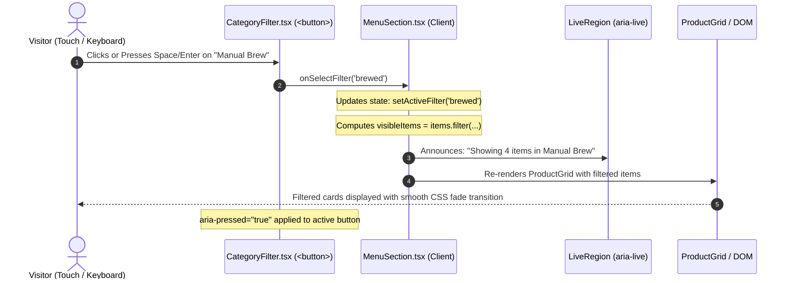
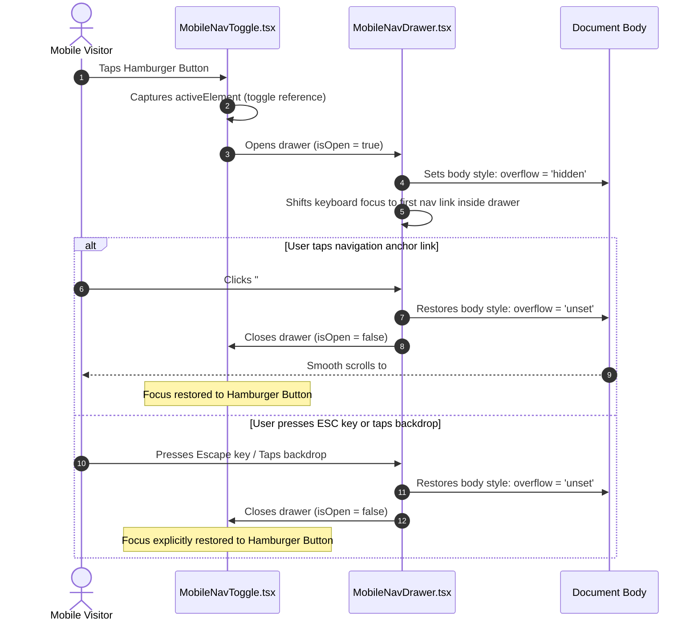

# Low-Level Design (LLD) — Premium Café Website

**Document Version:** 1.1 (Refined Planning Baseline)  
**Project:** Premium Café Website  
**Scope:** Frontend-only internship learning assignment  
**Status:** Complete — awaiting developer review and approval  

---

## 1. System Overview and Architectural Intent

The Low-Level Design (LLD) translates the approved High-Level Design (HLD) into concrete component structures, TypeScript contracts, state flows, and interaction rules. It enforces a strict frontend-only boundary with zero backend, database, or payment dependencies.

---

## 2. Component Hierarchy and Module Responsibilities

The application follows a clean tree structure designed to keep client bundle sizes small by isolating interactive islands:

```
RootLayout (src/app/layout.tsx) [SERVER]
│
├── Navbar (src/components/layout/Navbar.tsx) [SERVER]
│   ├── BrandLogo (Link -> #hero)
│   ├── DesktopNavLinks (Anchor Links: #hero, #featured, #menu, #about, #contact)
│   └── MobileNavToggle (src/components/layout/MobileNavToggle.tsx) [CLIENT]
│       └── MobileNavDrawer (src/components/layout/MobileNavDrawer.tsx) [CLIENT]
│
├── Page (src/app/page.tsx) [SERVER COMPOSITION ROOT]
│   │
│   ├── HeroSection (src/components/sections/Hero.tsx) [SERVER]
│   │   ├── HeroContent (Headline, Subtitle, CTA Anchor Link)
│   │   └── HeroVisual (src/components/ui/HeroVisual.tsx) [CONDITIONAL: Server or Client]
│   │
│   ├── FeaturedSection (src/components/sections/Featured.tsx) [SERVER]
│   │   ├── SectionHeader
│   │   └── FeaturedGrid
│   │       └── ProductCard (src/components/ui/ProductCard.tsx) [CONDITIONAL / LEAF]
│   │
│   ├── MenuSection (src/components/sections/MenuSection.tsx) [CLIENT ISLAND]
│   │   ├── SectionHeader
│   │   ├── CategoryFilter (src/components/ui/CategoryFilter.tsx)
│   │   ├── ProductGrid
│   │   │   └── ProductCard (src/components/ui/ProductCard.tsx) [CLIENT MODULE GRAPH LEAF]
│   │   └── EmptyState (src/components/ui/EmptyState.tsx)
│   │
│   ├── AboutSection (src/components/sections/About.tsx) [SERVER]
│   │   ├── StoryContent
│   │   └── AtmosphereGallery
│   │
│   └── ContactSection (src/components/sections/Contact.tsx) [SERVER]
│       ├── HoursAndLocation
│       └── ContactDetails
│
└── Footer (src/components/layout/Footer.tsx) [SERVER]
    ├── BrandSummary
    ├── QuickLinks
    └── CopyrightNotice
```

---

## 3. Server vs. Client Component Boundaries & Module Graph Mechanics

### 3.1 Understanding Next.js Client Component Import Rules

> [!IMPORTANT]
> **The Client Module Graph Rule:** In Next.js App Router, any component directly imported by a file marked with `'use client'` is automatically bundled into the client module graph and executed on the client.
> - Because `MenuSection.tsx` is a Client Component (managing active filter state), any component it directly imports—such as `CategoryFilter.tsx`, `ProductCard.tsx`, or `EmptyState.tsx`—becomes part of the client bundle.
> - Conversely, `FeaturedSection.tsx` is a Server Component. If it imports `ProductCard.tsx` directly without `'use client'` inside `ProductCard.tsx`, that instance renders on the server.
> - To avoid confusion, `ProductCard.tsx` can either:
>   - **Option A (Proposed):** Keep `ProductCard.tsx` free of `'use client'`, using pure CSS hover and anchor links. When imported by `MenuSection`, Next.js bundles its rendering logic into the client bundle cleanly without extra hook overhead.
>   - **Option B (Conditional):** Add `'use client'` to `ProductCard.tsx` only if internal stateful features (e.g., interactive modal dialogs, drawer expanders, or favorite toggles) are explicitly implemented.

### 3.2 Component Boundary Decisions

| Component | Architecture Type | State / Hooks | Boundary Justification |
|---|---|---|---|
| `layout.tsx` | **Server Component** | None | HTML shell, self-hosted font configuration, root metadata. |
| `page.tsx` | **Server Component** | None | Composition root; imports static data and passes it down via props. |
| `Navbar.tsx` | **Server Component** | None | Desktop anchors (`<a href="#...">`) and branding; embeds `MobileNavToggle`. |
| `MobileNavDrawer.tsx` | **Client Component** | `useState`, `useEffect` | Manages drawer open/close, locks body scroll, and traps keyboard focus. |
| `HeroSection.tsx` | **Server Component** | None | Static brand presentation; pure CSS animations run natively. |
| `HeroVisual.tsx` | **Conditional (Proposed: Server)** | *Option A: None*<br/>*Option B: onMouseMove* | **Option A (Proposed):** Pure CSS 3D transforms & hover (Server).<br/>**Option B:** Pointer tracking tilt (Client). |
| `FeaturedSection.tsx`| **Server Component** | None | Renders a static subset of featured items directly on the server. |
| `MenuSection.tsx` | **Client Component** | `useState` | Holds active filter state; filters the static item list in memory. |
| `CategoryFilter.tsx` | **Client Component** | Event callbacks | Renders filter buttons and emits selection events to `MenuSection`. |
| `ProductCard.tsx` | **Conditional (Proposed: CSS-only)** | *Option A: None*<br/>*Option B: useState* | **Option A (Proposed):** Pure CSS hover elevation, no internal hooks.<br/>**Option B:** Client component with modal/detail expansion. |
| `EmptyState.tsx` | **Client Component** | Event callback | Emits "Reset Filter" action to parent `MenuSection`. |
| `AboutSection.tsx` | **Server Component** | None | Static café philosophy and narrative gallery. |
| `ContactSection.tsx`| **Server Component** | None | Static hours, address, and interactive map link. |
| `Footer.tsx` | **Server Component** | None | Static copyright and footer navigation. |

---

## 4. TypeScript Contracts and Data Modeling

All contracts are minimal, maintainable, and strictly separated between domain data and UI filter state.

### 4.1 Domain Types (`src/types/menu.ts`)

```typescript
/** Product categories present in domain data */
export type ProductCategory = 'espresso' | 'brewed' | 'cold-craft' | 'pastries';

/** UI Filter identifier: combines all product categories with the 'all' pseudo-filter */
export type CategoryFilterId = 'all' | ProductCategory;

/** UI Filter tab model */
export interface CategoryFilterOption {
  readonly id: CategoryFilterId;
  readonly label: string;
}

/** Core café product domain model */
export interface MenuItem {
  readonly id: string;
  readonly name: string;
  readonly category: ProductCategory;
  readonly description: string;
  readonly price: number;
  readonly currency: string;
  readonly image: string;
  readonly featured: boolean;
  readonly tags?: readonly string[];
  readonly origin?: string;
}
```

> **Architecture Clarification:** Notice that `MenuItem.category` is strictly `ProductCategory` (`'espresso' | 'brewed' | 'cold-craft' | 'pastries'`). A product cannot have a category of `'all'`. `'all'` exists exclusively in `CategoryFilterId` for UI selection.

### 4.2 Component Props Contracts (`src/types/ui.ts`)

```typescript
import { MenuItem, CategoryFilterId, CategoryFilterOption } from './menu';

// Menu Section Props
export interface MenuSectionProps {
  readonly items: readonly MenuItem[];
}

// Category Filter Props
export interface CategoryFilterProps {
  readonly options: readonly CategoryFilterOption[];
  readonly activeFilter: CategoryFilterId;
  readonly onSelectFilter: (filterId: CategoryFilterId) => void;
  readonly itemCountMap: Readonly<Record<CategoryFilterId, number>>;
}

// Product Card Props
export interface ProductCardProps {
  readonly item: MenuItem;
  readonly priorityImage?: boolean;
}

// Empty State Props
export interface EmptyStateProps {
  readonly activeFilter: CategoryFilterId;
  readonly onReset: () => void;
}

// Mobile Navigation Drawer Props
export interface MobileNavDrawerProps {
  readonly isOpen: boolean;
  readonly onClose: () => void;
  readonly navLinks: readonly { readonly label: string; readonly href: string }[];
}

// Semantic Button Props (strictly for button actions)
export interface ButtonProps extends React.ButtonHTMLAttributes<HTMLButtonElement> {
  readonly variant?: 'primary' | 'secondary' | 'outline' | 'ghost';
  readonly size?: 'sm' | 'md' | 'lg';
  readonly fullWidthOnMobile?: boolean;
}

// Semantic Link Props (strictly for navigation)
export interface LinkButtonProps extends React.AnchorHTMLAttributes<HTMLAnchorElement> {
  readonly href: string;
  readonly variant?: 'primary' | 'secondary' | 'outline' | 'ghost';
  readonly size?: 'sm' | 'md' | 'lg';
  readonly fullWidthOnMobile?: boolean;
}
```

> **Semantic HTML Rule:** Buttons (`<button>`) are used for in-page actions (opening the drawer, selecting a category filter, resetting search). Links (`<a>` or `<Link>`) are used exclusively for navigation (jumping to `#menu`, `#about`, external maps). They are never combined into a single ambiguous component.

---

## 5. Illustrative Local Menu Data Structure (`src/data/menu.ts`)

> [!NOTE]
> The data below is **illustrative mock content** for testing component layouts and edge cases. Final product names, pricing, descriptions, and assets are independently decided by the developer.

```typescript
import { MenuItem, CategoryFilterOption } from '@/types/menu';

export const FILTER_OPTIONS: readonly CategoryFilterOption[] = [
  { id: 'all', label: 'All Offerings' },
  { id: 'espresso', label: 'Espresso & Milk' },
  { id: 'brewed', label: 'Manual Brew' },
  { id: 'cold-craft', label: 'Cold Craft' },
  { id: 'pastries', label: 'Artisan Bakery' },
];

export const MENU_ITEMS: readonly MenuItem[] = [
  {
    id: 'prod-01',
    name: 'Velvet Flat White',
    category: 'espresso',
    description: 'Double ristretto blended with micro-foamed whole milk, delivering notes of cocoa and toasted almond.',
    price: 4.80,
    currency: '$',
    image: '/images/products/flat-white.webp',
    featured: true,
    tags: ['Signature', 'House Blend'],
    origin: 'Colombia & Ethiopia',
  },
  {
    id: 'prod-02',
    name: 'Panama Geisha Pour-Over',
    category: 'brewed',
    description: 'Hand-poured V60 showcase with delicate jasmine aroma, bergamot sweetness, and clean peach finish.',
    price: 7.50,
    currency: '$',
    image: '/images/products/geisha-pourover.webp',
    featured: true,
    tags: ['Reserve', 'Single Origin'],
    origin: 'Boquete, Panama',
  },
  {
    id: 'prod-03',
    name: 'Nitro Vanilla Cold Brew',
    category: 'cold-craft',
    description: '18-hour cold steeped single-origin coffee infused with pure nitrogen and natural Madagascar vanilla.',
    price: 5.50,
    currency: '$',
    image: '/images/products/nitro-coldbrew.webp',
    featured: false,
    tags: ['Craft Keg', 'Dairy Free'],
    origin: 'Guatemala',
  },
  {
    id: 'prod-04',
    name: 'Cardamom Pistachio Babka',
    category: 'pastries',
    description: 'Twisted brioche layered with roasted pistachio paste and freshly crushed green cardamom.',
    price: 4.25,
    currency: '$',
    image: '/images/products/pistachio-babka.webp',
    featured: true,
    tags: ['Fresh Daily', 'Artisan Bakery'],
  },
];
```

---

## 6. State Ownership and Simple In-Memory Filtering

```
+---------------------------------------------------------------------------------+
| State Ownership Architecture                                                    |
+---------------------+-------------------+------------------+--------------------+
| State               | Owner Component   | Trigger          | Affected UI        |
+---------------------+-------------------+------------------+--------------------+
| activeFilter        | MenuSection.tsx   | Filter button tap| ProductGrid items  |
| isMobileNavOpen     | Navbar.tsx        | Hamburger tap/ESC| MobileNavDrawer    |
+---------------------+-------------------+------------------+--------------------+
```

### Direct In-Memory Filtering (No Premature useMemo)

For an in-memory dataset of 8–20 menu items, simple array filtering takes under `0.01ms`. Wrapping this in `useMemo` introduces hook overhead without tangible gain.

```typescript
// Inside MenuSection.tsx:
const [activeFilter, setActiveFilter] = useState<CategoryFilterId>('all');

// Simple, clear, and direct:
const visibleItems = activeFilter === 'all'
  ? items
  : items.filter(item => item.category === activeFilter);
```

---

## 7. Interaction Flows and Sequence Diagrams

### 7.1 Menu Filter Interaction Flow



### 7.2 Mobile Drawer Focus Management Flow



---

## 8. Context-Aware Responsive UI/UX Engineering

Responsive design must evaluate each component based on its **purpose, content, container, and context**, rather than enforcing universal font sizes or arbitrary grid columns.

### 8.1 Viewport Checkpoints (Testing Checkpoints, Not Layout Mandates)

Representative verification sizes: **320px, 360px, 375px, 390px, 430px, 640px, 768px, 1024px, 1280px, 1440px, 1920px**, plus mobile/tablet landscape orientations.

### 8.2 Component-Specific Responsive Rules

1. **Hero Section:**
   - *Mobile Portrait (320–430px):* Single-column vertical flow. Fluid heading (`~2rem`–`2.25rem`, tight line-height `~1.15`). CTA anchor button stretches to full width on narrow screens (`<380px`) with comfortable touch height (`~48px`).
   - *Mobile Landscape (e.g. 568×320, 667×375):* Vertical space is constrained. Section padding decreases (`py-6`) and visual height is capped (e.g. `max-h-[180px]`). **Do not force a rigid two-column layout** if content collides; allow natural wrapping based on available width and height.
   - *Desktop (1024px+):* Generous container spacing (`py-24 px-8`); headline fluidly scales (`~3.5rem`–`4.25rem`); CTA button adopts auto-width (`px-8 py-4`, height `~52px`).
2. **Category Filter Controls:**
   - *Mobile:* Horizontal scrolling container with hidden scrollbar and touch scroll-snap, or a compact wrapping row. Touch targets maintain a minimum padded envelope of `44×44px` even if visual pill is compact (`px-3.5 py-1.5`).
   - *Desktop:* Centered flex row with subtle container background and clear active pill styling.
3. **Product Card Grid:**
   - *Mobile (320–430px):* Single column (`w-full`, centered max `360px`). Card internal padding `p-4`.
   - *Tablet (640–768px):* 2 columns with `gap-6`. Card padding `p-5`.
   - *Desktop (1024px+):* 3 to 4 columns using CSS Grid `repeat(auto-fill, minmax(280px, 1fr))` with `gap-8`.
4. **Content Preservation & Text Clamping:**
   - Essential details (product title, price, currency, dietary badges) are **never** hidden behind line clamping.
   - Secondary description copy may use `line-clamp-2` or `line-clamp-3` on compact cards, provided the card design allows readable context or the full description is concise enough to fit naturally.

---

## 9. Accessibility Decisions (a11y)

### 9.1 Filter Controls: Filter Buttons vs. ARIA Tabs

> [!TIP]
> **Decision: Toggle Filter Buttons (`<button aria-pressed="...">`)**  
> While ARIA tabs (`role="tablist"` / `role="tab"` / `role="tabpanel"`) are valid, they require strict roving `tabindex` keyboard handling (ArrowLeft/Right navigation, Home/End, Space/Enter activation, and matching tabpanels). For a simple in-page category filter that controls a single product grid, **toggle filter buttons** grouped inside a semantic container (`<div role="group" aria-label="Filter menu by category">`) provide superior usability:
> - Standard `Tab` navigation works naturally without keyboard trapping bugs.
> - Each button carries `aria-pressed="true"` (active) or `aria-pressed="false"`.
> - Screen readers announce: *"Espresso & Milk, toggle button, pressed"*.
> - Updates are announced via an adjacent `<div aria-live="polite" className="sr-only">Showing X items</div>`.

### 9.2 Mobile Drawer Focus Management
- When opened: sets `aria-modal="true"` on the drawer dialog, locks body scroll, and focuses the first navigation link.
- Key listener captures `Escape` key to close.
- Focus trap prevents `Tab` navigation from leaking to the obscured background page.
- When closed: explicitly restores focus to the trigger button (`toggleRef.current?.focus()`).

### 9.3 Reduced-Motion Support
- Respects `prefers-reduced-motion: reduce`:
  ```css
  @media (prefers-reduced-motion: reduce) {
    *, ::before, ::after {
      animation-duration: 0.01ms !important;
      animation-iteration-count: 1 !important;
      transition-duration: 0.01ms !important;
      scroll-behavior: auto !important;
      transform: none !important;
    }
  }
  ```

---

## 10. Edge Cases and Defensive UI Handling

| Scenario | Potential Failure | Defensive Mitigation |
|---|---|---|
| **Empty Category Selection** | Blank screen or broken grid layout | `<EmptyState />` renders a friendly message ("No items currently available in this category") and a prominent "Reset to All Offerings" action button. |
| **Long Product Title** | Label overflow or price pushed down | Flex row with `justify-between` and `gap-2`; title wraps gracefully without clipping. |
| **Missing Image Asset** | Broken image icon and layout collapse | Image container specifies a subtle warm placeholder background with fallback icon. |
| **Missing Optional Fields** | Runtime undefined errors | Defensive rendering: `tags && tags.length > 0 && (...)`. |
| **320px Viewport** | Horizontal scrollbar or clipped text | `max-w-full`, box-border sizing, fluid typography clamps, and 100% width button envelopes. |

---

## 11. Component-Level Verification Checklist

- [ ] **Navbar & Links:** In-page links (`#hero`, `#menu`, `#about`, `#contact`) navigate smoothly; desktop links use semantic `<a>` tags.
- [ ] **Mobile Drawer:** Opens on tap, traps focus, closes on link click or ESC key, and restores focus to hamburger toggle.
- [ ] **Hero Section:** Responsive hierarchy verified at 320px, 375px, 768px, and 1280px; CTA anchor jumps to `#menu`.
- [ ] **Hero Visual:** CSS 3D perspective effect observable; remains static when reduced-motion is active.
- [ ] **Category Filter:** Clicking any filter button updates visible items; `aria-pressed` reflects active state; screen reader live region announces updated count.
- [ ] **Empty State:** Tested with simulated empty category; "Reset" button resets filter to `'all'`.
- [ ] **Product Cards:** Images display with correct aspect ratios; titles and prices remain fully visible without clipping.
- [ ] **Accessibility:** All interactive elements feature visible `:focus-visible` rings and satisfy minimum `44×44px` touch hit envelopes.
- [ ] **Layout Stability:** Zero horizontal scrolling across all viewports (320px–1920px).

---

## 12. Learning Reflection Questions

1. **Why do we separate `ProductCategory` from `CategoryFilterId` in TypeScript?**
   * *Answer:* In domain data, an actual coffee item belongs to a specific category like `'espresso'` or `'brewed'`. A product can never have a category of `'all'`. `'all'` is purely a UI concept for filtering. Separating them prevents domain modeling bugs.
2. **What happens when a Server Component is imported directly into a file marked with `'use client'`?**
   * *Answer:* Next.js App Router treats all direct imports inside a Client Component file as part of the client module graph. Even if the imported component has no `'use client'` header, its code is bundled and executed in the client browser.
3. **Why did we choose toggle filter buttons (`aria-pressed`) over the ARIA tabs pattern for category filtering?**
   * *Answer:* Full ARIA tabs require complex roving `tabindex` and arrow-key management with associated tabpanels. Toggle filter buttons (`<button aria-pressed="true|false">`) with an `aria-live` counter provide standard `Tab` keyboard accessibility and clear screen-reader announcements without roving-tabindex bugs.
4. **Why is `useMemo` unnecessary for filtering 8–20 menu items?**
   * *Answer:* Filtering a small array in memory takes less than a fraction of a millisecond. `useMemo` has memory and dependency-checking overhead that exceeds the cost of a simple JavaScript `.filter()`. Direct calculation keeps the code simpler and cleaner.

---

## 13. Remaining Risks & Open Decisions

1. **`ProductCard` Interaction Model:** Whether `ProductCard` remains a Server Component leaf (CSS hover elevation only) or a Client Component (interactive modal/detail drawer) will be finalized during implementation based on timeline and preference.
2. **Visual Assets:** High-resolution transparent PNG/WebP images of coffee cups and bakery items need to be gathered by the developer.
3. **Brand Styling Details:** Exact hex color codes (e.g. deep espresso `#16110E`, warm crema `#E5D3B3`) and Google Fonts choices remain developer decisions.
