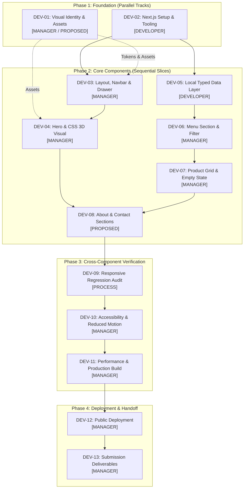

# Development Roadmap — Premium Café Website

**Document Version:** 1.1 (Refined Planning Baseline)  
**Project:** Premium Café Website  
**Scope:** Frontend-only internship learning assignment  
**Target Submission:** 22 November 2026, 10:00 PM PKT / 11:00 PM BST  
**Status:** Complete — awaiting developer review and approval  

---

## 1. Roadmap Architecture and Principles

This roadmap provides a phased, independent-learning implementation plan following the 14-stage development lifecycle. It guarantees that:

1. **Developer Ownership:** The developer authors all website implementation code and makes all visual design choices independently. AI acts solely as mentor, reviewer, debugger, and verification guide.
2. **Frontend-Only Discipline:** Zero backend, database, authentication, or payment services.
3. **Continuous Context-Aware Responsive Engineering:** Responsiveness is built directly into every component task from day one—evaluating purpose, container space, content length, typography, and touch ergonomics. It is not postponed to the end.
4. **Interactive Experience Coverage:** Explicitly incorporates smooth transitions, scroll-based effects, interactive menu cards, CSS 3D-style product visuals, and reduced-motion fallbacks with measurable acceptance criteria.
5. **Parallel Initial Stages:** Visual identity planning and environment initialization can proceed in parallel to maximize time efficiency.
6. **Learning & Verification Gates:** Every task concludes with technical checks, manual browser verification across viewports, 3–5 learning questions, and one small independent practice exercise.

---

## 2. Requirements Provenance & Priority Classification

Every task and feature is classified by its true origin:
- **[MANAGER] Core Requirement:** Explicit assignment deliverables (FR-01 to FR-10: Hero, 3D element, Interactive menu cards, Smooth transitions, Scroll-based effects, Typography, Responsive layout, Working frontend, HLD/LLD diagrams, LinkedIn demo). Mandatory for submission.
- **[DEVELOPER] Technical Choice:** Stack choices selected by the developer (FR-11 Next.js App Router/TypeScript, FR-12 Tailwind CSS/clsx/tailwind-merge).
- **[PROPOSED] Content Section:** Implementation suggestions (e.g., About story, Atmosphere gallery, Contact details). High brand value, but strictly optional under the manager's brief.
- **[PROCESS] Learning & Quality Rule:** Workflow gates, context-aware responsive reviews, and verification honesty standards.

---

## 3. Development Phases

```
Phase 1: Foundation & Setup (Stages 07-08) — Independent Parallel Tracks
   │
   ├─► DEV-01: Visual Identity & Asset Planning [MANAGER / PROPOSED]
   └─► DEV-02: Next.js App Router & Tooling Initialization [DEVELOPER]
   │
Phase 2: Core Components & Layout Slices (Stage 09)
   │
   ├─► DEV-03: Shared Layout, Navbar & Mobile Drawer [MANAGER / DEVELOPER]
   ├─► DEV-04: Hero Section, Scroll Effect & CSS 3D Visual [MANAGER]
   ├─► DEV-05: Local Typed Data Layer & Contracts [DEVELOPER]
   ├─► DEV-06: Menu Section, Filter Controls & Live Count [MANAGER]
   ├─► DEV-07: Interactive Product Cards Grid & Empty State [MANAGER]
   └─► DEV-08: About, Atmosphere & Contact Sections [PROPOSED]
   │
Phase 3: Cross-Component Verification & Quality (Stages 11-12)
   │
   ├─► DEV-09: Holistic Responsive Regression & Edge-Case Hardening [PROCESS]
   ├─► DEV-10: Accessibility Audit, Focus Traps & Reduced Motion [MANAGER / PROCESS]
   └─► DEV-11: Performance Optimization & Production Build [MANAGER / DEVELOPER]
   │
Phase 4: Deployment & Final Submission (Stages 13-14)
   │
   ├─► DEV-12: Public Deployment & Live Verification [MANAGER]
   └─► DEV-13: Submission Deliverables (HLD/LLD, Video/Demo) [MANAGER]
```

---

## 4. Detailed Task Breakdown

### DEV-01: Visual Identity & Asset Planning (Stage 07)
* **Provenance & Priority:** `[MANAGER]` (FR-01, FR-06) / `[PROPOSED]` (Brand styling)
* **Objective:** Establish café brand name, color tokens, typography pairings, and curate high-resolution transparent assets for CSS 3D layering. Can proceed in parallel with DEV-02.
* **Technical Concepts to Learn:**
  * Color harmony for artisan food/beverage brands (espresso `#16110E`, warm crema `#E5D3B3`, amber `#D4A373`).
  * WCAG 2.1 AA text contrast requirements (minimum 4.5:1 for body copy).
  * Web typography pairing (display serif like *Playfair Display* + clean sans-serif like *Inter*).
  * Asset preparation: transparent WebP/PNG formats to enable multi-layer CSS 3D depth without opaque background boxes.
* **Expected Developer Deliverable:**
  * Documented brand identity, color tokens, and font choices.
  * Curated transparent coffee cup and bean visual assets placed in `public/images/`.
* **Context-Aware Responsive Considerations:**
  * Assets must maintain visual clarity at both mobile dimensions (`240px`–`280px`) and desktop widescreen (`480px`+).
* **Manual Verification Steps:**
  1. Inspect curated assets on both light and dark backgrounds; verify clean alpha transparency.
  2. Test text/background contrast using a browser contrast checker.
* **Expected Observable Result:** Visual assets display clean edges without artifacting or square background cutouts.
* **Learning Questions:**
  1. Why is alpha transparency essential for multi-layer CSS 3D perspective scenes?
  2. How does contrast ratio impact readability on warm, moody café themes?
  3. What is the difference between display typography and body typography?
* **Independent Practice Exercise:** Select two contrasting coffee assets, inspect their natural aspect ratios in DevTools, and verify their file sizes are under 300KB.
* **Approval Gate:** Developer confirms brand name, tokens, and asset readiness.

---

### DEV-02: Next.js App Router & Tooling Initialization (Stage 08)
* **Provenance & Priority:** `[DEVELOPER]` (FR-11, FR-12)
* **Objective:** Initialize the Next.js App Router project with TypeScript, Tailwind CSS, `clsx`, and `tailwind-merge`. Can proceed in parallel with DEV-01.
* **Technical Concepts to Learn:**
  * Next.js App Router file structure (`src/app/`, `src/components/`, `src/lib/`, `src/types/`).
  * Verifying Tailwind CSS package compatibility (Tailwind v4 vs v3 configuration with Next.js PostCSS).
  * Constructing the `cn()` helper utility (`clsx` + `tailwind-merge`) for safe class overrides.
* **Expected Developer Deliverable:**
  * Bootstrapped Next.js project booting locally without default template clutter.
  * Configured `src/lib/utils.ts` exporting `cn()`.
  * Passing `npm run build` and `npm run dev`.
* **Context-Aware Responsive Considerations:**
  * Tailwind base styling configured with fluid container boundaries (`max-w-7xl mx-auto px-4 sm:px-6 lg:px-8`).
* **Manual Verification Steps:**
  1. Run `npm run build` in terminal; verify successful compilation without fatal errors.
  2. Start `npm run dev`; load `http://localhost:3000` in browser.
* **Expected Observable Result:** Clean blank homepage rendered with Tailwind utility classes active.
* **Learning Questions:**
  1. Why do we place application code under `src/` rather than the project root?
  2. What happens if two conflicting Tailwind padding classes (e.g. `p-4` and `p-6`) are applied without `tailwind-merge`?
  3. What is TypeScript strict mode, and why is it recommended for frontend development?
* **Independent Practice Exercise:** Test the `cn()` helper in a temporary component with conflicting classes (`cn('p-4 text-red-500', 'p-6')`) and confirm that `p-6` wins in the rendered DOM.
* **Approval Gate:** Local dev server runs cleanly and Tailwind utilities render as expected.

---

### DEV-03: Shared Layout, Navbar & Mobile Drawer (Stage 09.1)
* **Provenance & Priority:** `[MANAGER]` (FR-07 Responsive) / `[DEVELOPER]` (Layout structure)
* **Objective:** Implement the root layout, self-hosted Google Font loading via `next/font`, responsive header navigation, and accessible mobile drawer with smooth slide-in transition.
* **Technical Concepts to Learn:**
  * `next/font/google` for preloading typography without layout shifts or external network requests.
  * Server Component (`Navbar.tsx`) embedding an interactive Client Component (`MobileNavDrawer.tsx`).
  * Body scroll locking and focus management during drawer activation.
  * Context-aware mobile navigation: compact sticky bar (`56px`–`64px`), 44×44px hamburger hit envelope.
* **Expected Developer Deliverable:**
  * `src/app/layout.tsx` (fonts, global metadata, HTML shell).
  * `src/components/layout/Navbar.tsx` (Server Component).
  * `src/components/layout/MobileNavDrawer.tsx` (Client Component).
* **Context-Aware Responsive Requirements:**
  * *Mobile (<768px):* Brand logo left, hamburger button right; desktop links hidden.
  * *Desktop (>=768px):* Brand logo left, horizontal anchor links right; hamburger hidden.
  * *Landscape (<500px height):* Header stays compact; drawer content scrolls if navigation exceeds viewport height.
* **Required Interactions & Measurable Acceptance Criteria:**
  * **Smooth Transitions (FR-04):** Drawer slides in from right/left with CSS transition (`duration-300 ease-out`).
  * **Accessibility (NFR-03, NFR-04):** Tab navigation stays trapped inside open drawer; pressing `Escape` closes drawer; focus returns explicitly to hamburger button.
* **Manual Verification Steps:**
  1. At 375px width, tap hamburger; verify drawer slides in and background cannot be scrolled.
  2. Press `Tab` repeatedly; verify focus loops inside drawer links.
  3. Press `Escape`; verify drawer closes and focus restores to the hamburger toggle.
  4. Resize to 1024px; verify desktop links appear and hamburger disappears.
* **Expected Observable Result:** Header adapts seamlessly across viewports with zero horizontal overflow.
* **Learning Questions:**
  1. Why is `next/font` safer for performance than an external Google Fonts `<link>` tag?
  2. Why must we lock `document.body.style.overflow` when a mobile drawer is active?
  3. Why should focus be restored to the toggle button when a drawer closes?
* **Independent Practice Exercise:** Add a subtle backdrop blur (`backdrop-blur-md bg-stone-900/80`) to the sticky navbar and verify readability while scrolling past contrasting text.
* **Approval Gate:** Mobile drawer and desktop navbar pass functional and keyboard accessibility checks.

---

### DEV-04: Hero Section, Scroll Effect & CSS 3D Visual (Stage 09.2)
* **Provenance & Priority:** `[MANAGER]` (FR-01 Hero, FR-02 3D Element, FR-04 Transitions, FR-05 Scroll Effects)
* **Objective:** Implement the hero presentation with fluid typography, CTA anchor jump to `#menu`, at least one controlled scroll effect, and a CSS 3D-style coffee visual.
* **Technical Concepts to Learn:**
  * CSS 3D perspective (`perspective: 1200px`, `transform-style: preserve-3d`, `rotateX`, `rotateY`).
  * Scroll-linked or reveal effects (e.g. sticky header background transition upon scrolling past 50px, or scroll-reveal entrance).
  * Fluid typography using `clamp()` to scale smoothly between 320px and 1440px.
  * Reduced-motion fallback (`@media (prefers-reduced-motion: reduce)`).
* **Expected Developer Deliverable:**
  * `src/components/sections/Hero.tsx` (Server Component).
  * `src/components/ui/HeroVisual.tsx` (CSS 3D perspective layered elements).
  * Primary CTA linking to `#menu`.
* **Context-Aware Responsive Requirements:**
  * *Mobile (320–430px):* Single column stack; headline `~2rem`–`2.25rem` (`line-height: 1.15`); CTA button full-width on `<380px`, height `~48px`; coffee visual scaled comfortably (`max-h-[260px]`).
  * *Mobile Landscape (568×320):* Vertical space conservation; padding drops to `py-6`; coffee visual height capped at `180px`; headline and CTA visible above the fold. **Do not force an arbitrary two-column layout** if content is squashed.
  * *Desktop (1024px+):* Two-column balanced composition; headline `~3.5rem`–`4.25rem`; CTA button auto-width (`px-8 py-4`, height `~52px`); coffee visual displays full layered depth (`~480px`).
* **Required Interactions & Measurable Acceptance Criteria:**
  * **CSS 3D Product Presentation (FR-02):** Moving cursor or hovering tilts coffee visual by `6deg`–`10deg` along X and Y axes with depth layering.
  * **Scroll-Based Effect (FR-05):** Header background transitions from transparent to blurred solid when scrolling past the hero threshold, or hero elements smoothly fade on scroll.
  * **Reduced-Motion Fallback (NFR-06):** When reduced-motion is enabled, 3D tilt and floating animations are completely disabled (`transform: none !important; animation: none !important;`).
* **Manual Verification Steps:**
  1. Hover over the coffee visual; observe smooth 3D tilt and perspective depth.
  2. Click the Hero CTA; verify smooth scroll to the `#menu` anchor.
  3. Scroll down 100px; verify header background scroll-effect triggers smoothly.
  4. Enable `prefers-reduced-motion` in Chrome DevTools; verify motion ceases while presentation remains intact.
* **Expected Observable Result:** Visually engaging 3D hero with fluid text scaling and verified reduced-motion compliance.
* **Learning Questions:**
  1. What is the difference between a CSS 3D-style perspective effect and a WebGL 3D model?
  2. Why do we keep line-height tight (e.g. 1.1–1.15) on large display headings?
  3. How does the browser compositor handle CSS transforms differently from margin/top animations?
* **Independent Practice Exercise:** Modify the CSS 3D perspective value from `1200px` to `600px` and then `2000px` in DevTools to observe how perspective distance alters depth perception.
* **Approval Gate:** Hero section and scroll effect pass across mobile portrait, mobile landscape, and desktop.

---

### DEV-05: Local Typed Data Layer & Contracts (Stage 09.3 / 10)
* **Provenance & Priority:** `[DEVELOPER]` (FR-08, FR-11, Data Architecture)
* **Objective:** Author domain models, UI filter types, and local mock menu items representing all café categories with zero network dependencies.
* **Technical Concepts to Learn:**
  * Decoupling domain models (`ProductCategory`) from UI filter identifiers (`CategoryFilterId`).
  * TypeScript immutable arrays (`readonly MenuItem[]`).
  * Defensive data modeling (optional tags, origin strings, price formatting).
* **Expected Developer Deliverable:**
  * `src/types/menu.ts` (domain interfaces and union types).
  * `src/data/menu.ts` (8–15 realistic artisan café items).
* **Acceptance Criteria:**
  * Zero TypeScript compilation errors (`tsc --noEmit`).
  * `ProductCategory` union strictly covers `'espresso' | 'brewed' | 'cold-craft' | 'pastries'`.
  * Every item has valid display name, price, currency, image path, description, and category.
* **Manual Verification Steps:**
  1. Run `npx tsc --noEmit` in terminal.
  2. Verify that mock data matches the `MenuItem` interface.
* **Expected Observable Result:** TypeScript compiler outputs clean status with zero type errors.
* **Learning Questions:**
  1. Why should `MenuItem.category` not include the string `'all'`?
  2. What is the benefit of marking interface properties with `readonly`?
  3. Why does local static data provide higher reliability for an internship demo than a third-party API?
* **Independent Practice Exercise:** Add a new coffee item to `menu.ts` and purposefully introduce a type mismatch (e.g., `price: "4.50"` instead of `number`) to see TypeScript catch the error.
* **Approval Gate:** Data models and mock dataset compile cleanly without errors.

---

### DEV-06: Menu Section, Filter Controls & Live Count (Stage 09.4 / 10)
* **Provenance & Priority:** `[MANAGER]` (FR-03 Interactive Menu, FR-04 Transitions)
* **Objective:** Build the interactive menu container with accessible toggle filter buttons, active state styling, and screen-reader live announcements.
* **Technical Concepts to Learn:**
  * Client Component state management with `useState`.
  * Direct in-memory array filtering (without premature `useMemo`).
  * Accessible toggle buttons (`aria-pressed="true|false"`).
  * Screen-reader announcements via `aria-live="polite"`.
* **Expected Developer Deliverable:**
  * `src/components/sections/MenuSection.tsx` (Client Component).
  * `src/components/ui/CategoryFilter.tsx`.
* **Context-Aware Responsive Requirements:**
  * *Mobile (320–430px):* Horizontally scrollable pill bar with hidden scrollbar and scroll-snap, or compact wrapping row; touch hit envelope padded to `44×44px`.
  * *Desktop (1024px+):* Centered filter button group inside a subtle container backdrop.
* **Required Interactions & Measurable Acceptance Criteria:**
  * **Interactive Filter Actions (FR-03):** Clicking or pressing Enter on a filter button updates the visible products instantly.
  * **Smooth State Transitions (FR-04):** Filtered items enter with a smooth CSS fade/translate transition (`duration-200`).
  * **Screen Reader Feedback:** Live region announces: *"Showing X items in [Category]"*.
* **Manual Verification Steps:**
  1. Click each category filter in sequence; verify active styling shifts immediately.
  2. Inspect the DOM; verify `aria-pressed="true"` is applied to the active button.
  3. Verify keyboard navigation: `Tab` visits each button, `Enter` or `Space` activates it.
* **Expected Observable Result:** Menu updates instantaneously with zero layout thrashing or network delay.
* **Learning Questions:**
  1. Why are toggle filter buttons (`aria-pressed`) simpler and more accessible than ARIA tabs here?
  2. Why does in-memory filtering of 15 items not need `useMemo`?
  3. How does `aria-live="polite"` communicate changes to visually impaired visitors?
* **Independent Practice Exercise:** Use Chrome DevTools' screen reader simulator or VoiceOver/NVDA to listen to the filter announcements as you switch categories.
* **Approval Gate:** Category filter functions reliably across mouse, touch, and keyboard.

---

### DEV-07: Interactive Product Cards Grid & Empty State (Stage 09.5)
* **Provenance & Priority:** `[MANAGER]` (FR-03 Menu Cards, FR-06 Typography, FR-07 Responsive)
* **Objective:** Render the responsive product card grid with interactive hover elevation, pricing tags, item badges, and a friendly empty state.
* **Technical Concepts to Learn:**
  * Responsive CSS Grid (`grid-template-columns: repeat(auto-fill, minmax(280px, 1fr))`).
  * Next.js `<Image />` optimization with aspect ratio containers.
  * Defensive UI handling: preserving essential content without accidental line-clamp clipping.
  * Empty state with a "Reset to All" action.
* **Expected Developer Deliverable:**
  * `src/components/ui/ProductCard.tsx` (clean leaf component).
  * `src/components/ui/EmptyState.tsx`.
* **Context-Aware Responsive Requirements:**
  * *Mobile (320–430px):* Single column (`w-full`, max `360px` centered); card padding `p-4`; title `1.125rem`, price prominent.
  * *Tablet (640–768px):* 2 columns with `gap-6`; card padding `p-5`.
  * *Desktop (1024px+):* 3 to 4 columns (`gap-8`); card padding `p-6`; uniform card heights.
* **Required Interactions & Measurable Acceptance Criteria:**
  * **Interactive Card State (FR-03):** Hovering/focusing lifts card (`translateY(-4px)`), deepens shadow, and highlights border.
  * **Content Preservation:** Product title, price, currency, and dietary badges are **100% visible** without clipping.
  * **Empty State Handling:** When 0 items match, `<EmptyState />` appears with a working "Reset to All" button.
* **Manual Verification Steps:**
  1. Hover over product cards; observe smooth elevation and visible `:focus-visible` rings when tabbing.
  2. Verify prices and badges remain fully readable across 320px, 768px, and 1280px.
  3. Simulate an empty category; verify the empty state appears and clicking "Reset" returns to All Offerings.
* **Expected Observable Result:** Clean, polished product grid adapting seamlessly across all screen widths.
* **Learning Questions:**
  1. Why is `minmax(280px, 1fr)` more responsive than fixed media queries (`w-1/3`)?
  2. Why must essential data like price and allergens never be hidden behind `line-clamp`?
  3. How does Next.js `<Image />` prevent Cumulative Layout Shift (CLS)?
* **Independent Practice Exercise:** Temporarily add an item with a 4-line description to test how card flexbox keeps the bottom price and badge aligned with neighboring cards.
* **Approval Gate:** Product cards adapt cleanly and interact smoothly with pointer and keyboard.

---

### DEV-08: About, Atmosphere & Contact Sections (Stage 09.6)
* **Provenance & Priority:** `[PROPOSED]` (Suggested Single-Page Story Sections, not manager-mandated)
* **Objective:** Implement narrative brand storytelling, roasting philosophy, atmosphere imagery, and visit/contact details.
* **Technical Concepts to Learn:**
  * Server Component composition for static narrative copy.
  * Semantic HTML landmarks (`<section>`, `<address>`, `<footer>`).
  * Safe external link handling (`target="_blank" rel="noopener noreferrer"`).
* **Expected Developer Deliverable:**
  * `src/components/sections/About.tsx` (Server Component).
  * `src/components/sections/Contact.tsx` (Server Component).
  * `src/components/layout/Footer.tsx` (Server Component).
* **Context-Aware Responsive Requirements:**
  * *Mobile:* Single-column narrative; comfortable reading line length; contact info easily scannable.
  * *Desktop:* Multi-column layout pairing imagery with brand philosophy.
* **Manual Verification Steps:**
  1. Inspect text readability against backgrounds; verify contrast is comfortable.
  2. Verify all external links (map, socials) include `rel="noopener noreferrer"`.
* **Expected Observable Result:** Polished storytelling sections integrating naturally into the single-page experience.
* **Learning Questions:**
  1. Why should narrative sections remain Server Components in Next.js?
  2. Why is `rel="noopener noreferrer"` critical when opening external links?
  3. How do semantic `<address>` tags aid search engine scrapers and assistive technology?
* **Independent Practice Exercise:** Inspect the rendered DOM to verify semantic hierarchy: `<header>`, `<main>`, `<section>`, and `<footer>`.
* **Approval Gate:** Narrative sections render smoothly without affecting performance.

---

### DEV-09: Holistic Responsive Regression & Edge-Case Hardening (Stage 11.1)
* **Provenance & Priority:** `[PROCESS]` / `[MANAGER]` (FR-07 Responsive Layout, NFR-01, NFR-02)
* **Objective:** Perform a rigorous cross-component responsive regression audit across all 11 testing checkpoints and landscape orientations, resolving subtle edge cases.
* **Technical Concepts to Learn:**
  * Holistic viewport regression testing (inspecting interactions between neighboring sections).
  * Mobile landscape height constraints (`@media (max-height: 500px)`).
  * Root cause analysis of horizontal overflow (`overflow-x: clip`, box-sizing, negative margins).
* **Expected Developer Deliverable:**
  * Refined responsive CSS across all layout sections.
  * Documented verification results for all 11 test checkpoints.
* **Acceptance Criteria:**
  * Checkpoints verified: **320px, 360px, 375px, 390px, 430px, 640px, 768px, 1024px, 1280px, 1440px, 1920px**.
  * Mobile landscape (568×320, 667×375) tested: headings and CTAs remain visible without forced scrolling.
  * **Zero horizontal scrollbar** at any tested viewport.
* **Manual Verification Steps:**
  1. Cycle through every checkpoint in DevTools responsive mode.
  2. Inspect right-hand edges for any content overflowing past the viewport boundary.
  3. Test landscape mode on mobile presets (iPhone SE, Pixel, iPad).
* **Expected Observable Result:** Impeccable visual layout and touch usability across all resolutions.
* **Learning Questions:**
  1. Why are testing viewports distinct from CSS media query breakpoints?
  2. What are the common causes of horizontal overflow on mobile, and how are they eliminated?
  3. Why should mobile landscape avoid forcing content into two cramped columns?
* **Independent Practice Exercise:** Inject `* { outline: 1px solid red; }` in DevTools to visually trace which container touches or exceeds the viewport edge.
* **Approval Gate:** All 11 checkpoints pass verification with zero horizontal overflow.

---

### DEV-10: Accessibility Audit, Focus Traps & Reduced Motion (Stage 11.2)
* **Provenance & Priority:** `[MANAGER]` (NFR-03 Keyboard, NFR-04 Focus, NFR-05 Contrast, NFR-06 Reduced Motion)
* **Objective:** Execute an accessibility audit covering keyboard-only navigation, visible focus rings, focus traps, and reduced-motion fallbacks.
* **Technical Concepts to Learn:**
  * Keyboard navigation testing without a mouse.
  * High-contrast `:focus-visible` styling.
  * OS-level accessibility preference emulation.
* **Expected Developer Deliverable:**
  * Verified keyboard navigation through 100% of interactive controls.
  * High-contrast focus rings (`focus-visible:ring-2 focus-visible:ring-amber-500`).
  * Complete reduced-motion CSS overrides.
* **Acceptance Criteria:**
  * Every link, button, and filter is operable using Tab, Enter, Space, and Escape.
  * Focus rings are never hidden.
  * When reduced-motion is active, 3D tilt and floating animations cease immediately.
* **Manual Verification Steps:**
  1. Disconnect mouse; navigate the entire site using keyboard only.
  2. Verify focus indicator is distinctly visible on every focused element.
  3. Emulate `prefers-reduced-motion: reduce` in DevTools; confirm all motion stops.
* **Expected Observable Result:** Full accessibility compliance without keyboard traps or unreadable focus states.
* **Learning Questions:**
  1. What is the difference between `:focus` and `:focus-visible`?
  2. Why do vestibular disorders require `prefers-reduced-motion` support?
  3. Why should screen readers hear live updates when menu filters change?
* **Independent Practice Exercise:** Navigate from the top of the page to the bottom using only the `Tab` key and record how many keystrokes it takes to reach the menu filter.
* **Approval Gate:** 100% keyboard accessibility and reduced-motion compliance validated.

---

### DEV-11: Performance Optimization & Production Build (Stage 12)
* **Provenance & Priority:** `[MANAGER]` (FR-08 Working Frontend) / `[DEVELOPER]` (Production quality)
* **Objective:** Optimize assets, audit bundle sizes, and verify a clean production build.
* **Technical Concepts to Learn:**
  * Next.js production compilation (`next build`).
  * Image optimization with `next/image` (`sizes`, WebP/AVIF formats).
  * Eliminating browser console errors and unhandled exceptions.
* **Expected Developer Deliverable:**
  * Optimized production build output (`.next`).
  * Zero fatal compilation errors or runtime console exceptions.
* **Acceptance Criteria:**
  * `npm run build` succeeds cleanly.
  * Browser DevTools console displays zero runtime errors or unhandled warnings.
* **Manual Verification Steps:**
  1. Run `npm run build` in terminal.
  2. Run `npm run start` to serve the production build locally.
  3. Open browser console; navigate all sections; verify zero errors.
* **Expected Observable Result:** Production server boots quickly with optimized bundles and zero console errors.
* **Learning Questions:**
  1. How does Next.js optimize images during build and runtime?
  2. What is the difference between development mode (`npm run dev`) and production mode (`npm run start`)?
  3. How does code splitting keep initial page loads fast?
* **Independent Practice Exercise:** Inspect the Network tab in DevTools to observe which JavaScript chunks are loaded on initial paint versus when scrolling.
* **Approval Gate:** Production build passes cleanly and runs without errors.

---

### DEV-12: Public Deployment & Live Verification (Stage 13)
* **Provenance & Priority:** `[MANAGER]` (FR-08 Working Frontend, Deployment)
* **Objective:** Deploy the working application to a public hosting platform (e.g. Vercel or Netlify) and verify live behavior.
* **Technical Concepts to Learn:**
  * Continuous deployment integration.
  * Edge/CDN static asset caching.
  * Testing deployed environments on physical mobile devices.
* **Expected Developer Deliverable:**
  * Live public deployment URL.
* **Acceptance Criteria:**
  * Live site loads over HTTPS with zero deployment errors.
  * CSS 3D visuals, menu filters, and mobile navigation function identically to local build.
* **Manual Verification Steps:**
  1. Open live URL on a physical mobile phone; test touch navigation and filter buttons.
  2. Open live URL on desktop browser; test 3D visual tilt and smooth scrolling.
* **Expected Observable Result:** Fast, responsive, error-free public website accessible worldwide.
* **Learning Questions:**
  1. How does edge deployment reduce latency for international visitors?
  2. Why must frontend applications be verified on physical mobile devices in addition to DevTools emulators?
* **Independent Practice Exercise:** Run a Lighthouse audit on the live URL and observe performance and accessibility scores.
* **Approval Gate:** Public URL verified working and responsive.

---

### DEV-13: Submission Deliverables (Stage 14)
* **Provenance & Priority:** `[MANAGER]` (FR-09 Diagrams, FR-10 LinkedIn Demo, Section 14 Checklist)
* **Objective:** Assemble final submission deliverables: HLD/LLD diagrams, README documentation, and LinkedIn demonstration material.
* **Technical Concepts to Learn:**
  * Technical documentation and architecture communication.
  * Creating concise, professional engineering demonstrations.
* **Expected Developer Deliverable:**
  * Updated README with local setup instructions and architecture highlights.
  * Exported HLD and LLD diagrams matching the final code.
  * LinkedIn video or screenshot walkthrough mentioning Aravex Tech Studio (following company guidelines).
* **Acceptance Criteria:**
  * All items in PRD Section 14 Submission Checklist verified.
  * Standalone repository confirmed (no leakage of unrelated company projects).
* **Manual Verification Steps:**
  1. Verify repository contains only café website code.
  2. Review README for clear local setup instructions (`npm install`, `npm run dev`).
* **Expected Observable Result:** Complete, polished submission package ready for manager review.
* **Learning Questions:**
  1. Why is post-implementation architecture synchronization important in professional engineering?
  2. How does a well-crafted README communicate frontend craftsmanship to reviewers?
* **Independent Practice Exercise:** Perform a mock 2-minute walkthrough presentation explaining your component hierarchy and responsive design decisions.
* **Approval Gate:** Final assignment submission ready.

---

## 5. Task Dependencies & Sequence



---

## 6. Verification Honesty Policy (PRD Section 16 Alignment)

To maintain absolute integrity during implementation:
- **Checks Actually Executed:** Reported only when commands have run and real output is captured.
- **Checks Awaiting Developer Verification:** Visual styling, aesthetic appeal, and physical touch testing are marked as requiring developer verification.
- **Checks Not Yet Performed:** Explicitly identified; never claimed as passed prematurely.
- **No Unsupported Claims:** No claims of "guaranteed zero warnings" (third-party package warnings may occur naturally) or "60 FPS guarantees." Tooling and package compatibility must be verified through actual execution.

---

## 7. Submission Checklist (PRD Section 14 Alignment)

- [ ] Original website design decisions made by developer.
- [ ] Website code independently authored by developer (no AI generation).
- [ ] Working premium café homepage with hero and 3D visual effects.
- [ ] Interactive menu cards and category filter tested with pointer and keyboard.
- [ ] Mobile (320px), tablet, desktop, and landscape checks complete.
- [ ] HLD diagram matches final implementation.
- [ ] LLD diagram matches final component tree and flows.
- [ ] Clean production build without errors.
- [ ] Live deployment link active.
- [ ] LinkedIn video/screenshots prepared according to company guidelines.
- [ ] Standalone repository confirmed; no confidential company code included.

---

## 8. Recommended Next Task

Planning is finalized. The recommended next task is:

> **DEV-01: Visual Identity & Asset Planning (Stage 07 — UI/UX Design)**  
> *(Can proceed in parallel with DEV-02: Next.js Setup)*
> - Developer selects café brand name, typography pairing, and color tokens.
> - Developer curates transparent coffee cup and bakery assets.
> - Mentor provides briefing on contrast ratios, image formats, and asset directory structure.
